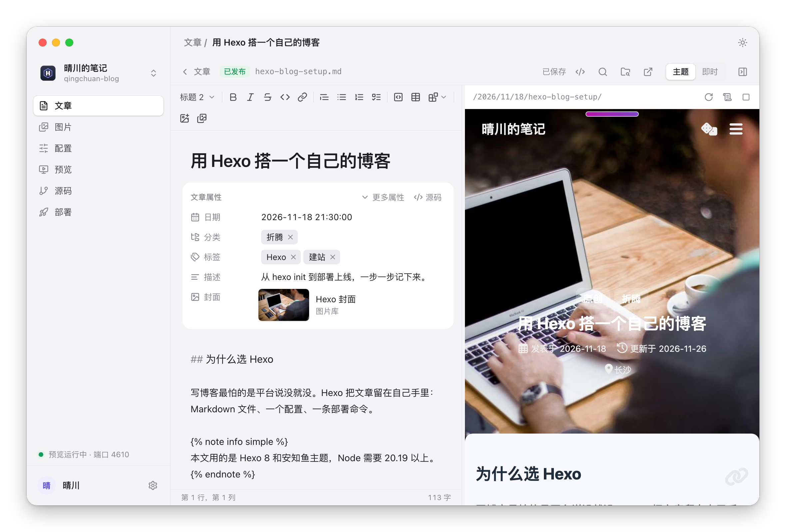
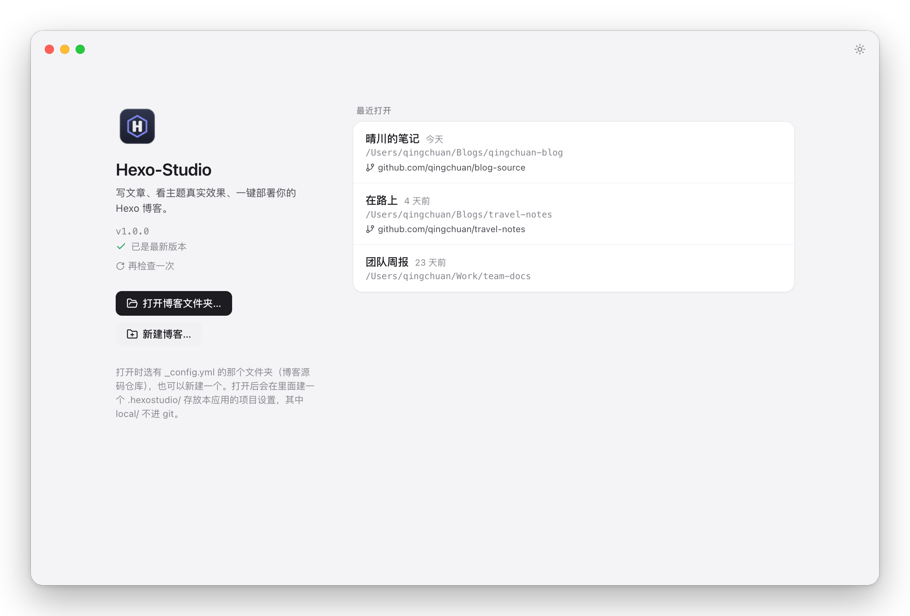
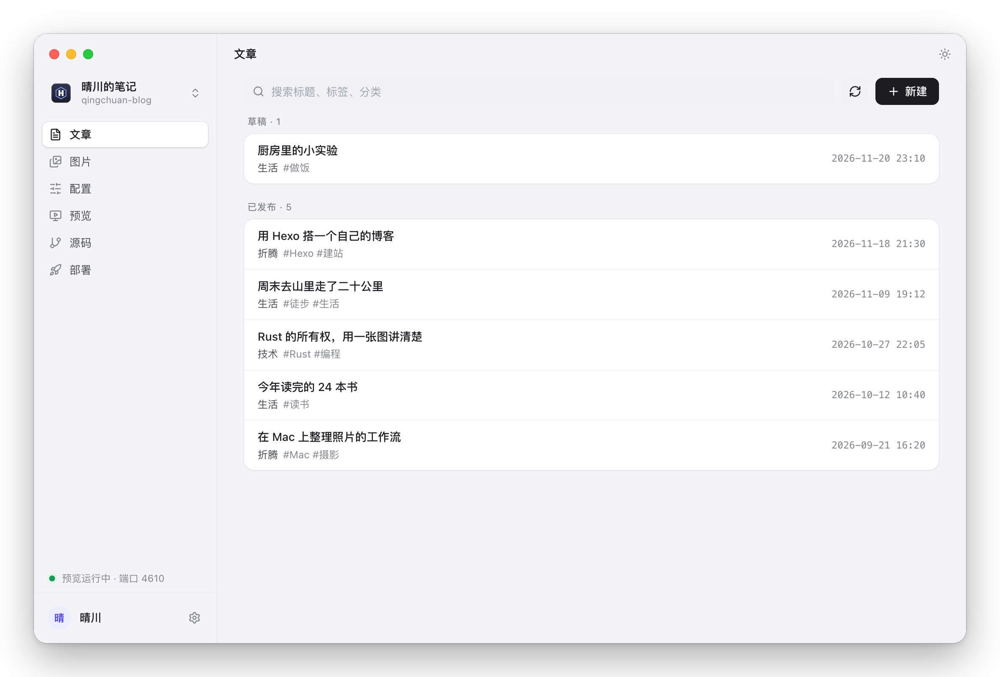
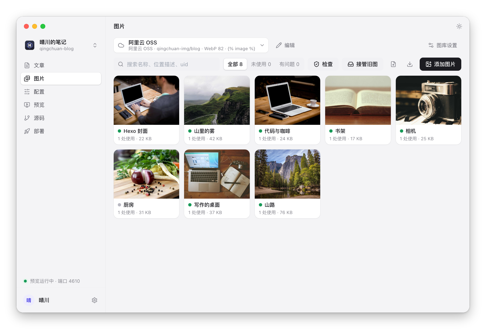
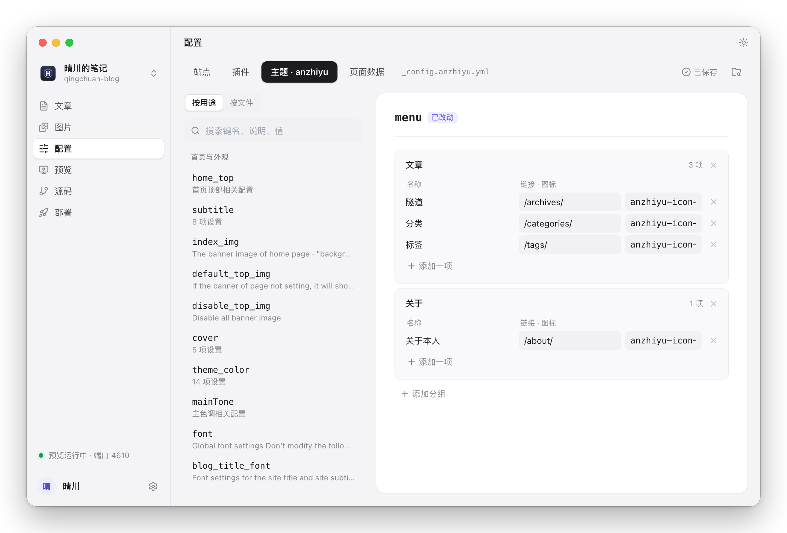
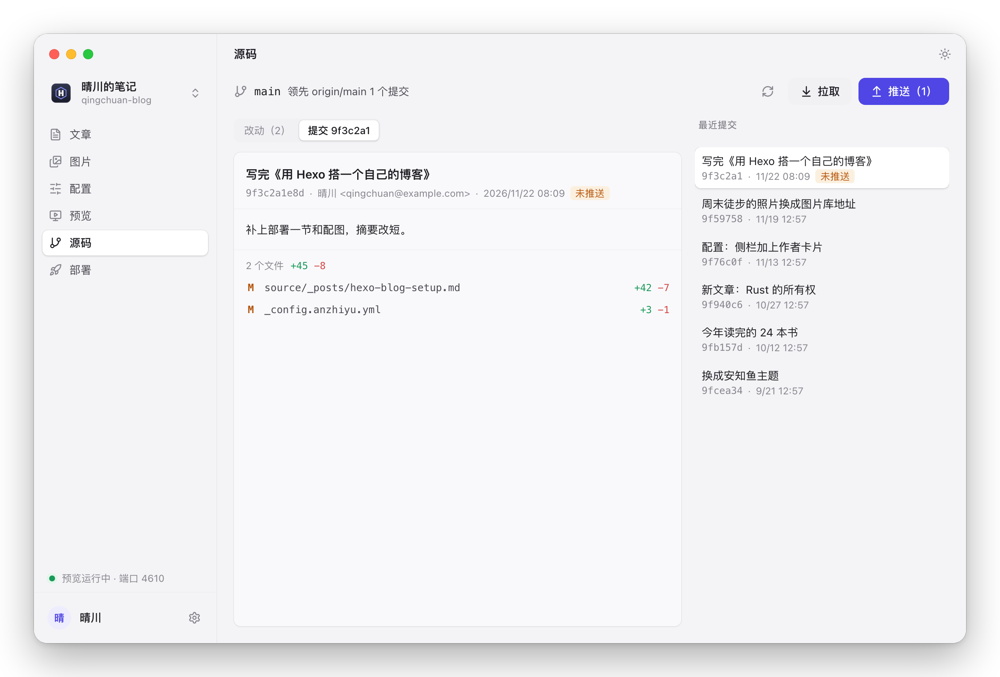
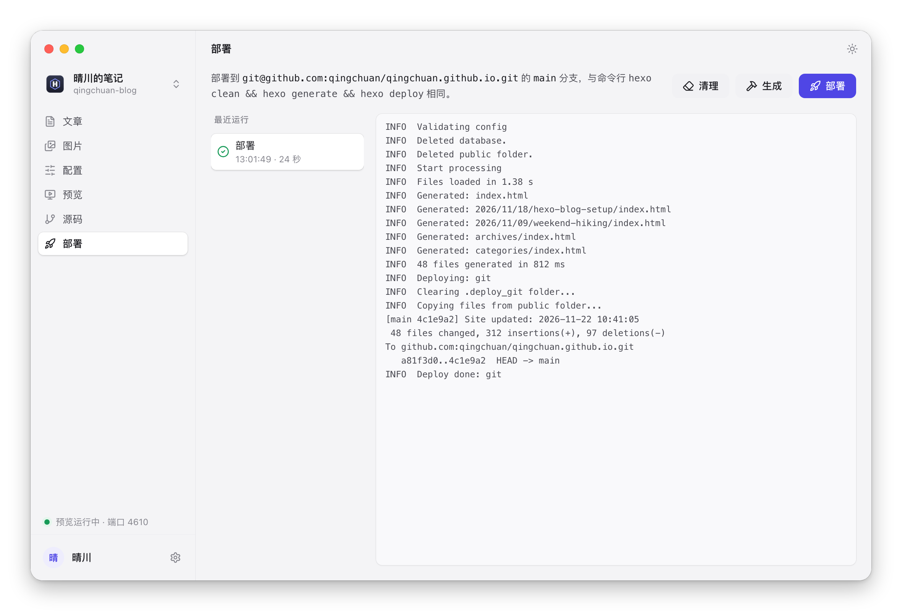
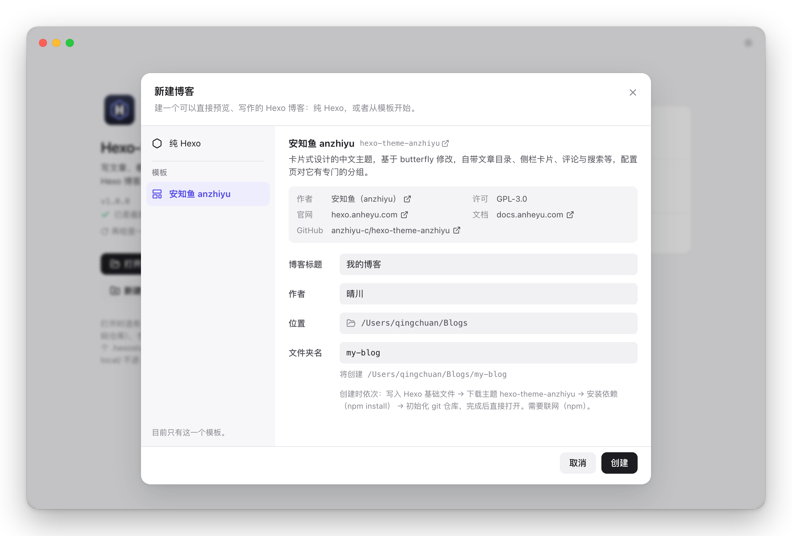
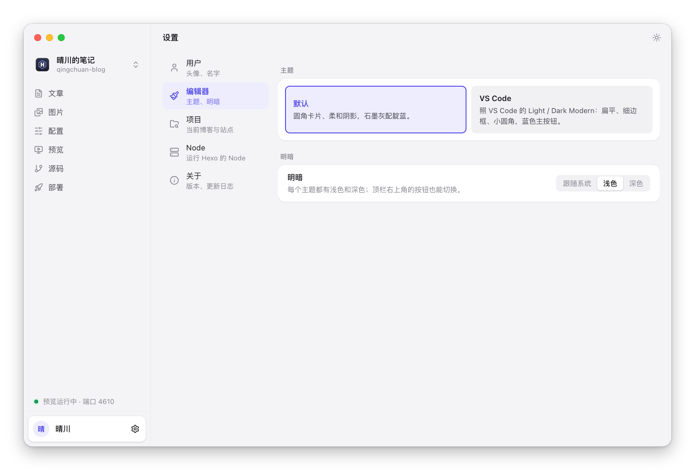
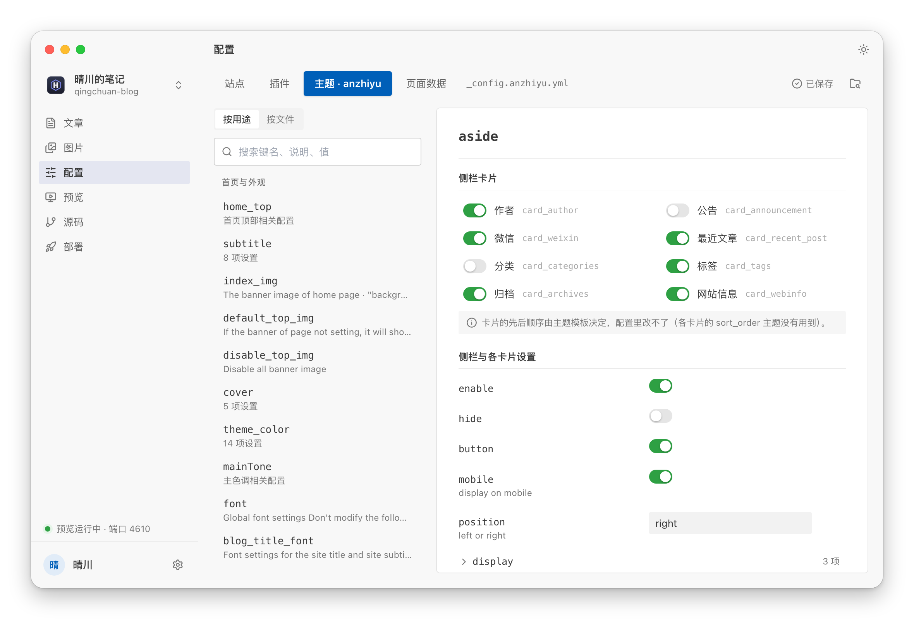

<div align="center">


# Hexo-Studio

**在 Mac 上写 Hexo 博客：一边写，一边看主题的真实效果；图片、配置、git 和部署都在一个窗口里。**

基于 Tauri 2（Rust + React）构建，支持 Apple Silicon 的 macOS。


[](https://github.com/EverettRain/Hexo-Studio/releases/latest)

<picture>
  <source media="(prefers-color-scheme: dark)" srcset="docs/images/editor-dark.png">
  
</picture>

</div>

## 目录

- [功能概览](#功能概览)
- [快速开始](#快速开始)
- [写作与预览](#写作与预览)
- [图片](#图片)
- [配置](#配置)
- [源码与部署](#源码与部署)
- [新建博客](#新建博客)
- [用户、设置与主题](#用户设置与主题)
- [数据存储](#数据存储)
- [开发](#开发)
- [发布](#发布)
- [已知限制](#已知限制)
- [License](#license)

## 功能概览

| 功能 | 说明 |
| --- | --- |
| 像 IDE 一样打开博客 | 欢迎页列出最近打开的博客；一个博客文件夹就是一个项目，应用的项目设置放在它的 `.hexostudio/` 里 |
| 所见即所得的主题预览 | 内嵌博客自己的 `hexo server --draft`，保存后自动刷新并回到原来的位置，看到的就是主题的真实效果 |
| 写作 | Markdown 编辑器带格式工具栏和常用快捷键；文章信息（front-matter）用日历、标签块等控件编辑，只改动改过的字段；自动保存 |
| 图片库 | 阿里云 OSS / S3 兼容存储，按项目统一管理；拖进窗口或粘贴截图，先看压缩效果再上传，默认转 WebP |
| 配置 | 站点、主题、插件、页面数据都能看、能改，保留注释和原有写法；安知鱼主题的常用分组有专门的控件 |
| 源码 | git 改动、提交、推送、拉取，点历史提交看改了哪些文件 |
| 部署 | 清理、生成、部署，与命令行相同；日志高亮，识别常见问题并给出处理办法 |
| 新建博客 | 纯 Hexo，或从模板（安知鱼）建好直接打开 |
| 主题 | 默认与 VS Code 风格两套界面主题，各有浅色和深色 |

## 快速开始

1. 从 [Releases](https://github.com/EverettRain/Hexo-Studio/releases/latest) 下载 `Hexo-Studio_x.y.z_aarch64.dmg`，把应用拖进「应用程序」。应用没有经过 Apple 公证，首次打开如提示“已损坏”或“无法验证开发者”，请运行 `xattr -cr /Applications/Hexo-Studio.app`。之后的版本可以在应用内更新。
2. 本机需要装有 Node.js（nvm、fnm、Volta、Homebrew 装的都能自动找到，找不到时可以在设置里指定）。Hexo 一律用博客自己的 `node_modules`，不内置、不下载。
3. 在欢迎页「打开博客文件夹…」选有 `_config.yml` 的那个文件夹（博客源码仓库），或者「新建博客…」。

<div align="center">

</div>

## 写作与预览

文章页按草稿和已发布列出全部文章，可以按标题、标签、分类搜索；「新建」用博客自己的模板（scaffolds）创建，与 `hexo new` 相同。

<div align="center">

</div>

打开一篇文章，左边是编辑器，右边是主题的真实预览：

- 文章信息单独一块显示在正文上方，日期、分类、标签、描述、封面各有控件；不认识的字段在「更多属性」里，或者切到源码直接改。写回时只改动改过的字段，其余原样保留。
- 工具栏覆盖标题、加粗、列表、代码、链接、表格和安知鱼的标签插件；Typora / Google Docs 的快捷键都能用。
- 正文里的图片显示成缩略图和图片库里的名称，点一下可以改写法（主题的 ``、Markdown、行内）、宽高和说明。
- 停止输入一秒后自动保存，预览刷新后回到原来的滚动位置。预览服务器也可以在「预览」页单独启动、停止、看日志。

## 图片

<div align="center">

</div>

- 图片按项目统一放在一个存储里，对象名是内容哈希，同一张图不会传两次；`.hexostudio/images.json` 记着每张图的名称、位置描述、地址和原图信息，随博客进 git。
- 可以建多套存储配置（阿里云 OSS、S3 兼容；桶、地域、路径、上传格式、插入写法成套保存），在图片页随时切换。AccessKey 只存在钥匙串里。
- 把图片拖进窗口、按 ⌘V 粘贴截图，或者点「添加图片」，都会先打开导入面板：在本机转换一遍，显示压缩前后的尺寸和体积，可以改质量、最长边、改名、填描述，再上传。在编辑器里上传完直接插入文章，其他地方把地址复制到剪贴板。
- 每张图被哪些页面使用、能不能访问（「检查」）都看得到；原图先存一份到本机。
- 「接管旧图」把博客里已有的、散放在存储里的图片收进图片库并改写文章里的地址；也可以导入 / 导出核对清单（CSV）。

## 配置

<div align="center">

</div>

- 四个分区：站点（`_config.yml`）、插件（按 `package.json` 里装了的插件列出各自的设置）、主题（`_config.<主题>.yml`）、页面数据（`source/_data` 里的友链、相册、装备等）。
- 所有字段都能看、能改：布尔值是开关，列表、对象逐层展开；字段说明取自配置文件里的注释。写回时只替换改动的那个值，注释、键的顺序、引号和日期写法都保留；磁盘上被别处改过时不会覆盖。
- 主题配置标出与主题默认值不同的地方；Hexo 合并列表时只增不减，列表按合并后的实际结果显示。
- 安知鱼主题按用途分组，并为导航菜单、评论与搜索服务、侧栏卡片、图片字段（接图片库）做了专门的控件；其他主题落回通用编辑器。
- 改了站点或主题配置后提示重启预览（Hexo 只在启动时读配置）；`admin` 的密码和密钥不显示、不编辑。

## 源码与部署

<div align="center">

</div>

源码页是博客源码仓库的 git：改动列表、标题与说明分开的提交、推送、拉取（只快进），点右侧的历史提交，直接在左边看它改了哪些文件。

<div align="center">

</div>

部署页的「清理」「生成」「部署」与 `hexo clean && hexo generate && hexo deploy` 相同。执行时会先停下预览服务器（它们写同一个 `db.json` 和 `public/`），结束后再恢复。日志按级别高亮；识别 GitHub 推送保护（GH013）、SSH 认证失败、缺少依赖、git 身份未设置等问题，给出放行链接或处理办法。

## 新建博客

<div align="center">

</div>

- 「纯 Hexo」与官方 `hexo init` 的结果相同（带 Hexo 自带的 landscape 主题）。
- 从模板新建：Hexo 的基础骨架加上主题。目前有安知鱼，主题从 npm 取（沿用你的 npm 镜像），默认配置整份复制成 `_config.anzhiyu.yml`；窗口里列出模板的作者、许可、官网、文档和仓库。
- 依赖用 `npm install` 装当时最新的版本（现在是 Hexo 8，需要 Node 20.19 以上），最后 `git init`。整个过程在旁边的隐藏文件夹里进行，全部成功才改名成目标文件夹；失败或取消不留任何文件。

## 用户、设置与主题

<div align="center">

</div>

- 侧栏左下角是用户面板（头像、名字），齿轮进入设置：用户、编辑器、项目、Node、关于（检查更新、更新日志）。
- 界面主题有「默认」和「VS Code」两套，各有浅色和深色；明暗也可以用右上角的按钮切换。

<div align="center">

</div>

## 数据存储

| 位置 | 内容 |
| --- | --- |
| `~/Library/Application Support/Hexo-Studio` | `app.json`（当前用户）、`users/<id>/`（名字、头像、偏好：主题、最近项目、Node 路径、原图备份目录等）、`logs/`。可以用环境变量 `HEXO_STUDIO_HOME` 改用其他目录 |
| 博客里的 `.hexostudio/` | `settings.json`（存储配置与上传参数）、`images.json`（图片库）随博客进 git，换电脑也带得走；`local/`（预览服务器进程号等本机状态）由它自己的 `.gitignore` 排除 |
| 钥匙串 | 每套存储的 AccessKey Secret，不写进任何文件 |
| `~/Pictures/Hexo-Studio` | 上传图片的原图备份（可在图片库设置里改） |

从旧版本升级时，原来的 `settings.json` 会迁移进第一个用户的偏好，旧文件改名为 `settings.migrated.json` 保留。

## 开发

需要 Node.js 22、pnpm 11 与 Rust 1.95（`app/rust-toolchain.toml` 会自动选用）。

```bash
cd app
pnpm install
pnpm tauri dev          # 开发运行
pnpm typecheck          # 前端类型检查
pnpm test               # 前端测试
pnpm test:rust          # Rust 测试
```

几组要用外部环境的测试默认跳过，设了环境变量才跑：`HEXO_STUDIO_TEST_CREATE=1`（真实联网新建博客）、`HEXO_STUDIO_TEST_S3=http://127.0.0.1:5005`（本地 S3 模拟，moto）、`HEXO_STUDIO_TEST_DATA=<数据目录的副本>`（旧设置迁移）。

代码按层组织（`domain` → `infra` → `service` → `shell`），设计说明见 [docs/design.md](docs/design.md)。

### README 截图

```bash
app/scripts/readme-screenshots.sh
```

不打开应用：`app/scripts/readme/demo.py` 建一个虚构的安知鱼示例博客（第一次需要联网）并由 Hexo 生成网页，界面用模拟后端（`app/scripts/readme/mock.ts`）构建后在无头 Chrome 里逐页渲染，窗口外框、红黄绿按钮和阴影画在透明背景上。编辑器里的预览就是示例博客的真实页面。需要 Google Chrome、Node 与 python3；不会读到你自己的博客和 Hexo-Studio 的数据。

## 发布

1. 在仓库的 **Settings → Secrets and variables → Actions** 中添加 `TAURI_SIGNING_PRIVATE_KEY`（updater 签名私钥的内容，无密码；本地放在已被忽略的 `signing/updater.key`）。对应的公钥已写在 `app/src-tauri/tauri.conf.json`。
2. 修改 `app/package.json`、`app/src-tauri/Cargo.toml` 与 `app/src-tauri/tauri.conf.json` 中的版本号，写好 `docs/releases/vX.Y.Z.md`，提交。
3. 推送 `vX.Y.Z` 标签，`release.yml` 构建 Apple Silicon 的 `.dmg` 与更新包并发布，版本说明取自 `docs/releases/vX.Y.Z.md`；应用内的更新检查读取最新 Release 的 `latest.json`，「设置 → 关于 → 更新日志」显示同一批说明。

## 已知限制

- 只支持 Apple Silicon 的 Mac；没有经过 Apple 签名公证，首次打开需要 `xattr -cr /Applications/Hexo-Studio.app` 或在「应用程序」里右键选「打开」。
- 一个窗口同时只打开一个博客、只有一个预览服务器。
- 配置页的专门控件、图片标签写法按安知鱼主题实现；其他主题可以用，配置落回通用编辑器。
- 预览服务器不会重新读取 `_config.yml` 和主题配置，改了要重启预览（配置页会提示）。

## License

[MIT](LICENSE)
